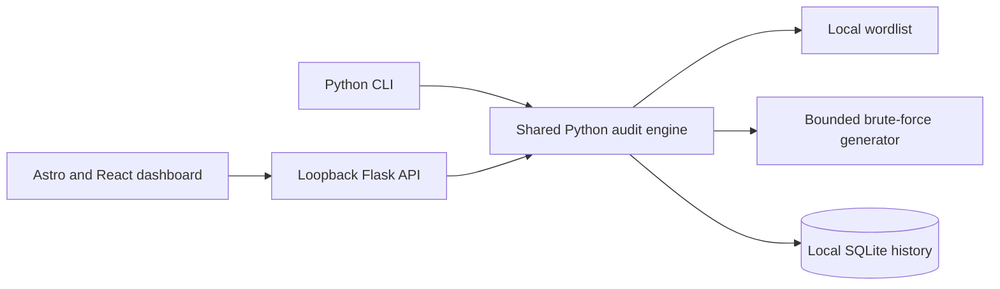

<!-- ===================== HEADER ===================== -->
<div align="center">
  
</div>

# Hash Cracker

A planned Python-based offline hash-cracking and password-auditing project. It identifies supported hash formats, compares a target against either a supplied dictionary or a bounded brute-force search, provides both a CLI and local web dashboard, and stores audit results in SQLite.

> **Project status: Implemented.** All four planned phases (33 tasks) are complete: hash identification, dictionary and bounded brute-force auditing, CLI and web dashboard, multiprocessing, and SQLite history. See the [quickstart](specs/001-offline-password-audit/quickstart.md) for setup and validated scenarios.

## Project Overview

The project demonstrates hash structure analysis, candidate generation, multiprocessing, CLI and web interface development, and local audit reporting. It is designed for authorized assessment of hashes and candidate inputs controlled by the operator. Hash checks run locally; the application does not attempt logins or contact remote targets.

Both interfaces will call the same Python audit engine. The engine will support:

- **Dictionary mode**: compare the target against each entry in a finite local wordlist.
- **Brute-force mode**: generate candidates from a selected character set and length range, stopping at a configured candidate budget.

## Supported Hashes

| Algorithm | Format                     | Support    |
| --------- | -------------------------- | ---------- |
| LM        | 16 hexadecimal characters  | Yes        |
| MD5       | 32 hexadecimal characters  | Yes        |
| NTLM      | 32 hexadecimal characters  | Yes        |
| MD4       | 32 hexadecimal characters  | Yes        |
| SHA-1     | 40 hexadecimal characters  | Yes        |
| SHA-224   | 56 hexadecimal characters  | Yes        |
| SHA-256   | 64 hexadecimal characters  | Yes        |
| SHA-384   | 96 hexadecimal characters  | Yes        |
| SHA-512   | 128 hexadecimal characters | Yes        |

Hash length and character structure help identify a format, but do not always prove the algorithm. MD5, NTLM, and MD4 share the same 32-character hexadecimal shape. The tool reports all three and requires an explicit selection. NTLM uses Passlib's `nthash`; LM uses Passlib's `lmhash` and compares only the first 8-byte DES block (16 hex), matching the format hashcat uses — a 16-hex LM target identifies passwords by their first seven characters. MD5, SHA-1, SHA-224, SHA-256, SHA-384, and SHA-512 use Python's `hashlib`; MD4 reuses the pure-Python MD4 implementation from the NTLM fallback (validated against RFC 1320 test vectors). Salted formats (`md5($pass.$salt)`, `sha256($salt.$pass)`, …) and adaptive formats (bcrypt, sha512crypt, phpass) are not supported in v1 — they need a salt input and different engine work.

## Features in Scope

- Automatic structure-based hash assessment with explicit selection for ambiguous shapes.
- Dictionary and bounded brute-force candidate modes.
- Multiprocessing to use multiple CPU cores, with a user-visible worker limit from 1 through 8.
- Candidate progress, total attempts, elapsed time, worker count, match/no-match status, and recovered plaintext.
- Both a CLI and local web dashboard.
- SQLite history including successful `plaintext : hash` pairs, attempts, elapsed time, algorithm, mode, workers, status, and timestamp.
- CSV/JSON export of local audit history.
- Local-only web application and local-only input processing.

## Workload Limits and Safety

- Brute-force runs require an explicit character set and minimum/maximum lengths.
- The default candidate budget is 1,000,000; the hard maximum is 10,000,000 candidates per run.
- Worker count defaults to 4 and cannot exceed 8.
- Wordlist uploads through the web dashboard are limited to 100 MiB; the CLI can use a larger local file.
- The web application binds to `127.0.0.1`, and state-changing browser requests use same-origin/CSRF protection.
- Successful plaintext/hash pairs are saved to local SQLite because the project brief requires them. The operator receives a sensitive-data warning before a run.
- Only hashes and candidate inputs the operator is authorized to assess should be used. The project does not support login attempts, remote targets, or external data transfer.

## Technology Stack

| Technology           | Planned role                                                                                              |
| -------------------- | --------------------------------------------------------------------------------------------------------- |
| **Python 3.11+**     | Hash analysis, audit engine, candidate processing, multiprocessing, CLI, Flask backend, and SQLite access |
| **`hashlib`**        | MD5 and SHA-256 candidate hashing                                                                         |
| **Passlib `nthash`** | NTLM candidate hashing                                                                                    |
| **Flask**            | Local web server and JSON API                                                                             |
| **Astro**            | Build the dashboard as static assets                                                                      |
| **React**            | Interactive hash, audit, progress, and result components                                                  |
| **JavaScript**       | Browser-side API requests and progress updates                                                            |
| **Tailwind CSS**     | Dashboard styling                                                                                         |
| **SQLite**           | Local audit history and result reporting                                                                  |
| **Node.js/npm**      | Frontend dependency installation and build                                                                |

### Go and Python

Go and Python can be used together, but the current plan does not use Go. Python already owns the core, CLI, and Flask server; adding a Go backend would introduce a second service and cross-language coordination without a requirement in the assignment.

## How the Application Will Work

1. The user submits a target hash through the CLI or dashboard.
2. The identifier checks its character structure and length, then lists compatible algorithms. If the shape is ambiguous, the user must select one.
3. The user chooses dictionary or brute-force mode and provides the mode-specific inputs.
4. The Python engine processes candidates with a bounded process pool, reporting progress and attempts.
5. Processing stops on a match, cancellation, or candidate budget.
6. SQLite records the run metadata. A successful run includes the recovered plaintext and target hash for reporting.



## Interfaces

### CLI

The planned command structure is:

```text
python -m password_audit identify HASH
python -m password_audit audit HASH --algorithm sha256 --mode dictionary --wordlist PATH --workers 4
python -m password_audit audit HASH --algorithm md5 --mode brute-force --charset lower,digits --min-length 1 --max-length 4 --max-candidates 10000 --workers 4
python -m password_audit history
python -m password_audit export report.csv --format csv
python -m password_audit serve
```

The exact command contract is in [contracts/cli.md](specs/001-offline-password-audit/contracts/cli.md). Successful results will include the plaintext/hash pair, attempts, and elapsed time; before a run, the CLI will warn that successful matches are retained locally.

### Local Web Dashboard

`python -m password_audit serve` serves the Astro build and Flask API together on `127.0.0.1`, default port `8765`. The dashboard offers algorithm selection, both candidate modes, progress monitoring, cancellation, recovered result display, and history review. It allows one active web audit at a time.

> **Always open the dashboard through the Flask server** — the JSON API exists only there. The built page opened through any other server shows a "Flask backend not detected" banner instead of failing silently. For frontend development, start the Flask server first so `npm run dev`/`npm run preview` can proxy `/api` to port 8765.

JSON routes:

- `POST /api/identify` — assess a hash and return compatible algorithms.
- `POST /api/audits` — start a dictionary or brute-force audit.
- `GET /api/audits/{job_id}` — retrieve progress and result.
- `POST /api/audits/{job_id}/cancel` — cancel the active job.
- `GET /api/history` — list local audit records.
- `POST /api/history/clear` — permanently delete all local audit records (CSRF-protected; the dashboard asks for confirmation first).

See the [web contract](specs/001-offline-password-audit/contracts/web.md) for the full JSON API contract.

## Implementation Plan: Four Required Phases

The work is organized into the four phases in the supplied student project guide. The [task plan](specs/001-offline-password-audit/tasks.md) contains **33 detailed tasks**, each mapped to files and dependencies.

### Phase 1: Hash Identification & Structure Analysis Module — T001–T007

| Task | Work                                                                                  |
| ---- | ------------------------------------------------------------------------------------- |
| T001 | Configure Python project metadata and Flask/Passlib dependencies.                     |
| T002 | Define supported formats, digest lengths, normalization, and candidate algorithms.    |
| T003 | Implement MD5/SHA-256 with `hashlib` and NTLM with Passlib.                           |
| T004 | Require explicit selection when one input shape matches multiple supported formats.   |
| T005 | Add the CLI `identify` command and input errors.                                      |
| T006 | Add the Flask JSON identification endpoint.                                           |
| T007 | Document supported hash shapes and the MD5/NTLM ambiguity in the interface contracts. |

### Phase 2: Multi-Threaded Dictionary & Brute-Force Cracking Engine — T008–T015

| Task | Work                                                                            |
| ---- | ------------------------------------------------------------------------------- |
| T008 | Stream wordlists and read them in bounded chunks.                               |
| T009 | Generate brute-force candidates from explicit character sets and length limits. |
| T010 | Implement a shared comparison worker for MD5, SHA-256, and NTLM.                |
| T011 | Add bounded multiprocessing, 1–8 workers, cancellation, and chunk scheduling.   |
| T012 | Enforce a 1,000,000 default candidate budget and 10,000,000 hard maximum.       |
| T013 | Track attempts, elapsed time, worker count, progress, state, and match.         |
| T014 | Add CLI arguments for modes and their inputs.                                   |
| T015 | Document input rules and synthetic validation cases.                            |

### Phase 3: CLI / Web Dashboard Interface — T016–T025

| Task | Work                                                                                                                       |
| ---- | -------------------------------------------------------------------------------------------------------------------------- |
| T016 | Connect CLI audits to the shared engine and print progress and results.                                                    |
| T017 | Warn and require acknowledgement before storing successful plaintext/hash pairs.                                           |
| T018 | Implement loopback-only Flask serving and CSRF protection.                                                                 |
| T019 | Add web job start, status, and cancellation routes.                                                                        |
| T020 | Validate 100 MiB uploads and clean up temporary files.                                                                     |
| T021 | Set up Astro, React, Tailwind, and frontend build scripts.                                                                 |
| T022 | Build dashboard controls for hash identification, algorithm ambiguity, mode, charset, limits, and workers.                 |
| T023 | Connect audit requests, progress polling, cancellation, plaintext/hash results, and the pre-run retention acknowledgement. |
| T024 | Style forms, progress, warnings, and results with Tailwind.                                                                |
| T025 | Build and package static frontend assets served by Flask; document local launch.                                           |

### Phase 4: Result Storage & Audit Logging — T026–T033

| Task | Work                                                                                        |
| ---- | ------------------------------------------------------------------------------------------- |
| T026 | Create SQLite schema and local connection handling.                                         |
| T027 | Save target hash, algorithm, mode, status, worker count, attempts, duration, and timestamp. |
| T028 | Save successful plaintext/hash pairs and show the sensitive-data warning.                   |
| T029 | Connect CLI terminal outcomes to SQLite.                                                    |
| T030 | Add history listing and CSV/JSON export.                                                    |
| T031 | Add dashboard history and successful result display.                                        |
| T032 | Document records, database location, exports, and retention warning.                        |
| T033 | Walk through the phase validation scenarios with synthetic data and refine the quickstart.  |

## Repository Layout (implemented)


```text
README.md
LICENSE.md
pyproject.toml
src/password_audit/
├── __init__.py
├── __main__.py
├── algorithms.py
├── hashing.py
├── candidates.py
├── bruteforce.py
├── engine.py
├── history.py
├── cli.py
├── web.py
└── static/                     # Astro output served by Flask
frontend/
├── package.json
├── astro.config.mjs
└── src/
    ├── pages/index.astro
    ├── components/AuditDashboard.jsx
    └── styles/global.css
specs/001-offline-password-audit/
├── spec.md
├── plan.md
├── research.md
├── data-model.md
├── quickstart.md
├── tasks.md
└── contracts/
    ├── cli.md
    └── web.md
```

This layout is implemented; `static/` holds the Astro build output (gitignored) and is created by `npm run build`.

## Setup

Requirements: Python 3.11+, Node.js/npm compatible with Astro, and a modern browser. Internet access may be required to install dependencies, but audit operations are designed to run offline. The application runs on **Windows, Linux, and macOS**.

### Windows (PowerShell)

```powershell
python -m venv .venv
.\.venv\Scripts\Activate.ps1
python -m pip install -e .
Set-Location frontend
npm install
npm run build
Set-Location ..
```

Shortcut: `.\serve.ps1` starts the dashboard on the venv's interpreter without activating it (`.\serve.ps1 -Port 9000` chooses a port).

### Linux / macOS (bash)

```bash
python3 -m venv .venv
.venv/bin/python -m pip install -e .
cd frontend && npm install && npm run build && cd ..
```

Shortcut: `./serve.sh` starts the dashboard on the venv's interpreter without activating it (`./serve.sh 9000` chooses a port).

After setup, `python -m password_audit identify ...`, `audit ...`, `history`, `export ...`, and `serve` are available (the installed `password-audit` console script works the same way on every platform); see the CLI contract for options and exit codes. The only platform differences are venv paths (`Scripts\` on Windows, `bin/` elsewhere) and the `python` vs `python3` command name.

## Performance and Validation

The performance target is to compare 100,000 short dictionary entries in under 60 seconds on a typical student laptop. This target is not measured yet. Brute-force search is bounded by its configured candidate budget. Planned manual scenarios use synthetic hashes and candidate data to check identification, dictionary matching, brute-force matching, progress, worker limits, cancellation, storage, and reports.

## Current Status

- The specification, design documents, contracts, and four-phase task plan are complete; all 33 tasks are implemented and marked done in [tasks.md](specs/001-offline-password-audit/tasks.md).
- The Python package (`src/password_audit/`) provides hash identification, dictionary/brute-force auditing, multiprocessing, the CLI, the Flask API, and SQLite history.
- The Astro/React/Tailwind dashboard builds into `src/password_audit/static/` and is served by the loopback Flask server.
- The performance target (100,000 dictionary entries in under 60 seconds) and other numbers come from manual synthetic-data validation, not an automated test suite; no formal tests are included.

## License

The repository includes the [MIT License](LICENSE.md). Replace `[Copyright Holder]` in that file with the copyright owner's name or organization before publication.

## Project Documents

- [Specification](specs/001-offline-password-audit/spec.md)
- [Implementation plan](specs/001-offline-password-audit/plan.md)
- [Technical decisions](specs/001-offline-password-audit/research.md)
- [Data model](specs/001-offline-password-audit/data-model.md)
- [Four-phase task plan](specs/001-offline-password-audit/tasks.md)
- [Quickstart and validation scenarios](specs/001-offline-password-audit/quickstart.md)
- [CLI contract](specs/001-offline-password-audit/contracts/cli.md)
- [Web contract](specs/001-offline-password-audit/contracts/web.md)
  <!-- ===================== FOOTER ===================== -->
  <div align="center">
    
  </div>
