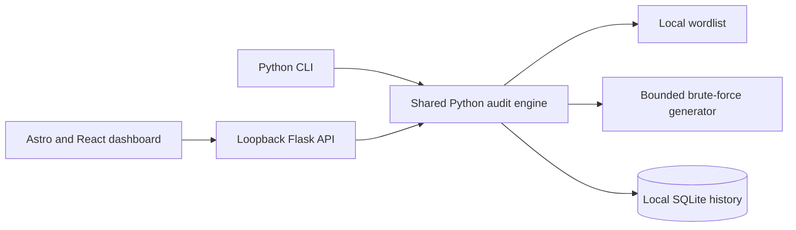

<!-- ===================== HEADER ===================== -->
<div align="center">
  
</div>

# Hash Cracker

[](https://github.com/xismail606/hash-cracker/actions/workflows/ci.yml)

A Python-based offline hash-cracking and password-auditing project. It identifies supported hash formats, compares a target against either a supplied dictionary or a bounded brute-force search, provides both a CLI and local web dashboard, and stores audit results in SQLite.

> **Project status: Implemented.** All 33 v1 tasks and the v2 feature expansion (salted formats, hashlists, mutation rules, benchmark, pause/resume, dashboard export/ETA, plaintext withholding/encryption, RIPEMD-160 and adaptive formats) are complete, backed by a 131-test pytest suite with CI. See the [quickstart](specs/001-offline-password-audit/quickstart.md) for setup and validated scenarios.

## Project Overview

The project demonstrates hash structure analysis, candidate generation, multiprocessing, CLI and web interface development, and local audit reporting. It is designed for authorized assessment of hashes and candidate inputs controlled by the operator. Hash checks run locally; the application does not attempt logins or contact remote targets.

Both interfaces call the same Python audit engine. The engine supports:

- **Dictionary mode**: compare the target against each entry in a finite local wordlist, with optional mutation rules (leetspeak, digit suffixes, …).
- **Hashlist mode**: audit many targets (one per line in a hashlist file) against one candidate stream in a single pass.
- **Benchmark**: per-algorithm candidates/second on this machine (`benchmark` command).
- **Pause/resume** dashboard jobs, **ETA** display, CSV/JSON **export from the dashboard**, and an option to **withhold plaintext** or **encrypt it at rest** (passphrase-based).
- **Brute-force mode**: generate candidates from a selected character set and length range, stopping at a configured candidate budget.

## Supported Hashes

| Algorithm | Format                     | Support    |
| --------- | -------------------------- | ---------- |
| LM        | 16 hexadecimal characters  | Yes        |
| MD5       | 32 hexadecimal characters  | Yes        |
| NTLM      | 32 hexadecimal characters  | Yes        |
| MD4       | 32 hexadecimal characters  | Yes        |
| SHA-1     | 40 hexadecimal characters  | Yes        |
| SHA-224   | 56 hexadecimal characters  | Yes        |
| SHA-256   | 64 hexadecimal characters  | Yes        |
| SHA-384   | 96 hexadecimal characters  | Yes        |
| SHA-512   | 128 hexadecimal characters | Yes        |
| RIPEMD-160 | 40 hexadecimal characters | Yes (pure-Python, hashcat 600) |
| SHA-512/224 | 56 hexadecimal characters | Yes        |
| SHA-512/256 | 64 hexadecimal characters | Yes        |
| bcrypt    | full hash string ($2…)      | Yes (slow — see note) |
| sha512crypt | full hash string ($6$…)   | Yes (slow — see note) |
| phpass    | full hash string ($P$…)     | Yes (slow — see note) |

Hash length and character structure help identify a format, but do not always prove the algorithm. MD5, NTLM, and MD4 share the same 32-character hexadecimal shape. The tool reports all three and requires an explicit selection. NTLM uses Passlib's `nthash`; LM uses Passlib's `lmhash` and compares only the first 8-byte DES block (16 hex), matching the format hashcat uses — a 16-hex LM target identifies passwords by their first seven characters. MD5, SHA-1, SHA-224, SHA-256, SHA-384, and SHA-512 use Python's `hashlib`; MD4 reuses the pure-Python MD4 implementation from the NTLM fallback (validated against RFC 1320 test vectors). RIPEMD-160 is a dependency-free pure-Python implementation validated against the official test vectors. Adaptive formats (bcrypt, sha512crypt, phpass) verify against the full stored hash string via Passlib and are extremely slow — keep their brute-force budgets small (the `benchmark` command reports real per-algorithm throughput). Eight salted fast-hash formats are also supported (`md5($pass.$salt)`, `md5($salt.$pass)`, `sha1($pass.$salt)`, `sha1($salt.$pass)`, `sha256($pass.$salt)`, `sha256($salt.$pass)`, `sha512($pass.$salt)`, `sha512($salt.$pass)`) — pass the known salt with `--salt` (CLI) or the dashboard salt field.

## Features in Scope

- Automatic structure-based hash assessment with explicit selection for ambiguous shapes.
- Dictionary and bounded brute-force candidate modes.
- Multiprocessing to use multiple CPU cores, with a user-visible worker limit from 1 through 8.
- Candidate progress, total attempts, elapsed time, worker count, match/no-match status, and recovered plaintext.
- Both a CLI and local web dashboard.
- SQLite history including successful `plaintext : hash` pairs, attempts, elapsed time, algorithm, mode, workers, status, and timestamp.
- CSV/JSON export of local audit history.
- Local-only web application and local-only input processing.

## Workload Limits and Safety

- Brute-force runs require an explicit character set and minimum/maximum lengths.
- The default candidate budget is 1,000,000; the hard maximum is 10,000,000 candidates per run.
- Worker count defaults to 4 and cannot exceed 8.
- Wordlist uploads through the web dashboard are limited to 100 MiB; the CLI can use a larger local file.
- The web application binds to `127.0.0.1`, and state-changing browser requests use same-origin/CSRF protection.
- Successful plaintext/hash pairs are saved to local SQLite because the project brief requires them. The operator receives a sensitive-data warning before a run.
- Only hashes and candidate inputs the operator is authorized to assess should be used. The project does not support login attempts, remote targets, or external data transfer.

## Technology Stack

| Technology           | Role                                                                                                      |
| -------------------- | --------------------------------------------------------------------------------------------------------- |
| **Python 3.11+**     | Hash analysis, audit engine, candidate processing, multiprocessing, CLI, Flask backend, and SQLite access |
| **`hashlib`**        | MD5 and SHA-256 candidate hashing                                                                         |
| **Passlib `nthash`** | NTLM candidate hashing                                                                                    |
| **Flask**            | Local web server and JSON API                                                                             |
| **Astro**            | Build the dashboard as static assets                                                                      |
| **React**            | Interactive hash, audit, progress, and result components                                                  |
| **JavaScript**       | Browser-side API requests and progress updates                                                            |
| **Tailwind CSS**     | Dashboard styling                                                                                         |
| **SQLite**           | Local audit history and result reporting                                                                  |
| **Node.js/npm**      | Frontend dependency installation and build                                                                |

### Go and Python

Go and Python can be used together, but the current plan does not use Go. Python already owns the core, CLI, and Flask server; adding a Go backend would introduce a second service and cross-language coordination without a requirement in the assignment.

## How the Application Works

1. The user submits a target hash through the CLI or dashboard.
2. The identifier checks its character structure and length, then lists compatible algorithms. If the shape is ambiguous, the user must select one.
3. The user chooses dictionary, brute-force, or hashlist mode and provides the mode-specific inputs.
4. The Python engine processes candidates with a bounded process pool, reporting progress and attempts.
5. Processing stops on a match, cancellation, or candidate budget.
6. SQLite records the run metadata. A successful run includes the recovered plaintext and target hash for reporting.



## Usage Guide

All commands work on Windows (`python`), Linux/macOS (`python3`, or the venv
path), and the installed console script (`password-audit`). Exit codes:
**0** success, **1** invalid input, **2** cancelled/interrupted, **3** storage
failure. Run `python -m password_audit --help` for the full option list.

### 1. Identify a hash

```bash
python -m password_audit identify 8743b52063cd84097a65d1633f5c74f5
# → 32-hex shapes are ambiguous: MD5 / NTLM / MD4 — choose explicitly
python -m password_audit identify 127e6fbf...  # 64-hex: SHA-256 or SHA-512/256
python -m password_audit identify b89eaac7...  # 40-hex: SHA-1 or RIPEMD-160
python -m password_audit identify 299bd128c1101fd6  # 16-hex: LM
python -m password_audit identify '$2a$05$...'  # prefix-recognized: bcrypt
```

Supported shapes: LM (16), MD5/NTLM/MD4 (32, ambiguous), SHA-1/RIPEMD-160 (40,
ambiguous), SHA-224/SHA-512-224 (56, ambiguous), SHA-256/SHA-512-256 (64,
ambiguous), SHA-384 (96), SHA-512 (128). Adaptive formats (bcrypt `$2…`,
sha512crypt `$6$…`, phpass `$P$…`) are recognized by prefix — the full stored
hash string is the target.

### 2. Dictionary audit (wordlist)

Create a local UTF-8 wordlist — one candidate per line — and audit a target
against it:

```bash
# words.txt contains: hashcat, password, 123456, ...
python -m password_audit audit 8743b52063cd84097a65d1633f5c74f5 \
    --algorithm md5 --mode dictionary --wordlist words.txt --workers 4
```

Behavior: only line endings are stripped; duplicates are attempted in order;
blank lines count as attempts; invalid UTF-8 bytes are replaced (never fatal).
A match prints the plaintext/hash pair and stores it in local SQLite after
the retention acknowledgement (`--yes` skips the interactive prompt,
`--no-store-plaintext` records the match without the plaintext).

### 3. Brute-force audit (bounded)

```bash
python -m password_audit audit 8743b52063cd84097a65d1633f5c74f5 \
    --algorithm md5 --mode brute-force \
    --charset lower,digits --min-length 1 --max-length 4 \
    --max-candidates 10000 --workers 4
```

- `--charset` accepts presets (`lower`, `upper`, `digits`, `symbols`) and
  literal text, comma-separated (e.g. `lower,digits` or `abc123`)
- Stops at a match, the budget (default 1,000,000; hard max 10,000,000), or
  Ctrl+C; a truncated space reports `budget_exhausted`
- Pick a realistic budget with `python -m password_audit benchmark`

### 4. Salted formats

```bash
python -m password_audit audit 3d83c8e717ff0e7ecfe187f088d69954 \
    --algorithm md5_pass_salt --salt 343141 \
    --mode dictionary --wordlist words.txt
```

Eight salted formats (hashcat modes 10/20/110/120/1410/1420/1710/1720) take
the known salt stored alongside the hash; `--salt` is required for them and
rejected for unsalted formats.

### 5. Hashlist — many targets, one pass

```text
# targets.txt — one per line; prefix the ambiguous 32-hex shapes
md5:8743b52063cd84097a65d1633f5c74f5
127e6fbfe24a750e72930c220a8e138275656b8e5d8f48a98c3c92df2caba935
ntlm:b4b9b02e6f09a9bd760f388b67351e2b
```

```bash
python -m password_audit audit --hashlist targets.txt \
    --mode dictionary --wordlist words.txt
```

Each candidate is hashed once per distinct target algorithm and probed against
all targets; the CLI prints a per-target result table and history stores one
record per target plus a batch summary.

### 6. Rules — wordlist mutations

```bash
python -m password_audit audit a13b856f261e2a517ed184e777a6128a \
    --algorithm md5 --mode dictionary --wordlist words.txt \
    --rules append_digits_0_99
```

Presets: `capitalize`, `upper`, `lower`, `leetspeak`, `append_digits_0_99`,
`append_years`, `all`. The expanded stream (original word first, then
variants) respects the candidate budget exactly.

### 7. History and reports

```bash
python -m password_audit history                 # newest first
python -m password_audit history --limit 10
python -m password_audit export report.csv --format csv
python -m password_audit export report.json --format json
```

Successful matches include the plaintext/hash pair. Encrypted rows show
`<encrypted>` until `history --unlock` (or `--passphrase`) is provided.

### 8. Benchmark

```bash
python -m password_audit benchmark --seconds 1
```

Prints per-algorithm candidates/second on this machine to guide budget
choices (informational; never stored).

### 9. Dashboard

```bash
python -m password_audit serve        # or .\serve.ps1 / ./serve.sh
```

Open `http://127.0.0.1:8765`. The dashboard offers hash identification with
algorithm chips, salted-format selection with a salt field, hashlist upload,
both audit modes with mutation rules, workers 1–8, live progress with ETA,
pause/resume, cancellation, per-target result tables, audit history with
CSV/JSON export and clear-all, and a changelog modal in the navbar.

> **Always open the dashboard through the Flask server** — the JSON API exists only there. The built page opened through any other server shows a "Flask backend not detected" banner instead of failing silently. For frontend development, start the Flask server first so `npm run dev`/`npm run preview` can proxy `/api` to port 8765.

JSON routes:

- `POST /api/identify` — assess a hash and return compatible algorithms.
- `POST /api/audits` — start a dictionary, brute-force, salted, or hashlist audit.
- `GET /api/audits/{job_id}` — retrieve progress, per-target results, and outcome.
- `POST /api/audits/{job_id}/pause` / `resume` — checkpoint and continue a job.
- `POST /api/audits/{job_id}/cancel` — cancel the active job.
- `GET /api/history` — list local audit records.
- `POST /api/history/clear` — permanently delete all local audit records.
- `POST /api/history/unlock` — provide the encryption passphrase.
- `GET /api/export?format=csv|json` — download the full history.
- `GET /api/session` — CSRF token for state-changing requests.

See the [CLI contract](specs/001-offline-password-audit/contracts/cli.md) and
[web contract](specs/001-offline-password-audit/contracts/web.md) for the full
contracts.

## Implementation Plan: Four Required Phases

The work is organized into the four phases in the supplied student project guide. The [task plan](specs/001-offline-password-audit/tasks.md) contains **33 detailed tasks**, each mapped to files and dependencies.

### Phase 1: Hash Identification & Structure Analysis Module — T001–T007

| Task | Work                                                                                  |
| ---- | ------------------------------------------------------------------------------------- |
| T001 | Configure Python project metadata and Flask/Passlib dependencies.                     |
| T002 | Define supported formats, digest lengths, normalization, and candidate algorithms.    |
| T003 | Implement MD5/SHA-256 with `hashlib` and NTLM with Passlib.                           |
| T004 | Require explicit selection when one input shape matches multiple supported formats.   |
| T005 | Add the CLI `identify` command and input errors.                                      |
| T006 | Add the Flask JSON identification endpoint.                                           |
| T007 | Document supported hash shapes and the MD5/NTLM ambiguity in the interface contracts. |

### Phase 2: Multi-Threaded Dictionary & Brute-Force Cracking Engine — T008–T015

| Task | Work                                                                            |
| ---- | ------------------------------------------------------------------------------- |
| T008 | Stream wordlists and read them in bounded chunks.                               |
| T009 | Generate brute-force candidates from explicit character sets and length limits. |
| T010 | Implement a shared comparison worker for MD5, SHA-256, and NTLM.                |
| T011 | Add bounded multiprocessing, 1–8 workers, cancellation, and chunk scheduling.   |
| T012 | Enforce a 1,000,000 default candidate budget and 10,000,000 hard maximum.       |
| T013 | Track attempts, elapsed time, worker count, progress, state, and match.         |
| T014 | Add CLI arguments for modes and their inputs.                                   |
| T015 | Document input rules and synthetic validation cases.                            |

### Phase 3: CLI / Web Dashboard Interface — T016–T025

| Task | Work                                                                                                                       |
| ---- | -------------------------------------------------------------------------------------------------------------------------- |
| T016 | Connect CLI audits to the shared engine and print progress and results.                                                    |
| T017 | Warn and require acknowledgement before storing successful plaintext/hash pairs.                                           |
| T018 | Implement loopback-only Flask serving and CSRF protection.                                                                 |
| T019 | Add web job start, status, and cancellation routes.                                                                        |
| T020 | Validate 100 MiB uploads and clean up temporary files.                                                                     |
| T021 | Set up Astro, React, Tailwind, and frontend build scripts.                                                                 |
| T022 | Build dashboard controls for hash identification, algorithm ambiguity, mode, charset, limits, and workers.                 |
| T023 | Connect audit requests, progress polling, cancellation, plaintext/hash results, and the pre-run retention acknowledgement. |
| T024 | Style forms, progress, warnings, and results with Tailwind.                                                                |
| T025 | Build and package static frontend assets served by Flask; document local launch.                                           |

### Phase 4: Result Storage & Audit Logging — T026–T033

| Task | Work                                                                                        |
| ---- | ------------------------------------------------------------------------------------------- |
| T026 | Create SQLite schema and local connection handling.                                         |
| T027 | Save target hash, algorithm, mode, status, worker count, attempts, duration, and timestamp. |
| T028 | Save successful plaintext/hash pairs and show the sensitive-data warning.                   |
| T029 | Connect CLI terminal outcomes to SQLite.                                                    |
| T030 | Add history listing and CSV/JSON export.                                                    |
| T031 | Add dashboard history and successful result display.                                        |
| T032 | Document records, database location, exports, and retention warning.                        |
| T033 | Walk through the phase validation scenarios with synthetic data and refine the quickstart.  |

## Repository Layout (implemented)


```text
README.md
LICENSE.md
pyproject.toml
src/password_audit/
├── __init__.py
├── __main__.py
├── algorithms.py
├── hashing.py
├── candidates.py
├── bruteforce.py
├── engine.py
├── history.py
├── cli.py
├── web.py
└── static/                     # Astro output served by Flask
frontend/
├── package.json
├── astro.config.mjs
└── src/
    ├── pages/index.astro
    ├── components/AuditDashboard.jsx
    └── styles/global.css
specs/001-offline-password-audit/
├── spec.md
├── plan.md
├── research.md
├── data-model.md
├── quickstart.md
├── tasks.md
└── contracts/
    ├── cli.md
    └── web.md
```

This layout is implemented; `static/` holds the Astro build output (gitignored) and is created by `npm run build`.

## Setup

Requirements: Python 3.11+, Node.js/npm compatible with Astro, and a modern browser. Internet access may be required to install dependencies, but audit operations are designed to run offline. The application runs on **Windows, Linux, and macOS**.

### One-command setup (recommended)

Download the repository and run the setup script for your platform — it installs Python dependencies (with all extras), Node dependencies, and builds the dashboard:

```powershell
# Windows
powershell -ExecutionPolicy Bypass -File .\setup.ps1
```

```bash
# Linux / macOS / Git Bash
./setup.sh
```

Both scripts are idempotent (safe to re-run) and run the test suite at the end. `setup.ps1 -SkipFrontend` / `./setup.sh --skip-frontend` skip the npm steps.

### Manual setup

#### Windows (PowerShell)

```powershell
python -m venv .venv
.\.venv\Scripts\Activate.ps1
python -m pip install -e .
Set-Location frontend
npm install
npm run build
Set-Location ..
```

Shortcut: `.\serve.ps1` starts the dashboard on the venv's interpreter without activating it (`.\serve.ps1 -Port 9000` chooses a port).

### Linux / macOS (bash)

```bash
python3 -m venv .venv
.venv/bin/python -m pip install -e .
cd frontend && npm install && npm run build && cd ..
```

Shortcut: `./serve.sh` starts the dashboard on the venv's interpreter without activating it (`./serve.sh 9000` chooses a port).

After setup, `python -m password_audit identify ...`, `audit ...`, `history`, `export ...`, and `serve` are available (the installed `password-audit` console script works the same way on every platform); see the CLI contract for options and exit codes. The only platform differences are venv paths (`Scripts\` on Windows, `bin/` elsewhere) and the `python` vs `python3` command name.

## Performance and Validation

The performance target is to compare 100,000 short dictionary entries in under 60 seconds on a typical student laptop; the `benchmark` command reports measured per-algorithm candidates/second on this machine so budgets can be sized accordingly. Brute-force search is bounded by its configured candidate budget. Automated pytest scenarios (`tests/`, 131 tests) check identification, dictionary and brute-force matching, hashlists, rules, progress accounting, pause/resume, export, plaintext withholding, encryption, and history behavior with synthetic hashes and candidate data.

## Current Status

- The specification, design documents, contracts, and both task plans are complete; all 33 v1 tasks and the v2 expansion tasks (T034–T076) are implemented and marked done in their `tasks.md` files.
- The Python package (`src/password_audit/`) provides hash identification (including salted, adaptive, RIPEMD-160, and SHA-512/224+/256 formats), dictionary/brute-force/hashlist auditing, mutation rules, multiprocessing, the benchmark command, pause/resume, the CLI, the Flask API, and SQLite history with optional at-rest encryption.
- The Astro/React/Tailwind dashboard builds into `src/password_audit/static/` and is served by the loopback Flask server; it adds pause/resume, ETA, CSV/JSON export, plaintext-withholding and encryption controls, and history unlock.
- Behavior is locked in by a 131-test pytest suite running on Windows and Ubuntu via GitHub Actions CI.

## License

The repository includes the [MIT License](LICENSE.md). Replace `[Copyright Holder]` in that file with the copyright owner's name or organization before publication.

## Changelog

See [CHANGELOG.md](CHANGELOG.md) — or the clock icon in the dashboard navbar —
for the full release history (v1.0.0 initial release, v1.1.0 format expansion,
v2.0.0 feature expansion).

## Project Documents

- [Specification](specs/001-offline-password-audit/spec.md)
- [Implementation plan](specs/001-offline-password-audit/plan.md)
- [Technical decisions](specs/001-offline-password-audit/research.md)
- [Data model](specs/001-offline-password-audit/data-model.md)
- [Four-phase task plan](specs/001-offline-password-audit/tasks.md)
- [Quickstart and validation scenarios](specs/001-offline-password-audit/quickstart.md)
- [CLI contract](specs/001-offline-password-audit/contracts/cli.md)
- [Web contract](specs/001-offline-password-audit/contracts/web.md)

## Feature Expansion Plan (v2) — Implemented

The v2 round planned in [specs/002-feature-expansion/](specs/002-feature-expansion/) is complete: salted fast-hash formats, hashlist multi-target audits, rule-based mutations, tooling/UX upgrades (benchmark, pause/resume, dashboard export, ETA, plaintext withholding), a pytest suite with CI, optional plaintext encryption at rest, and the researched formats (RIPEMD-160, adaptive bcrypt/sha512crypt/phpass, SHA-512/224 and SHA-512/256). See its [spec](specs/002-feature-expansion/spec.md), [plan](specs/002-feature-expansion/plan.md), and [task breakdown](specs/002-feature-expansion/tasks.md) (T034–T076).
  <!-- ===================== FOOTER ===================== -->
  <div align="center">
    
  </div>
